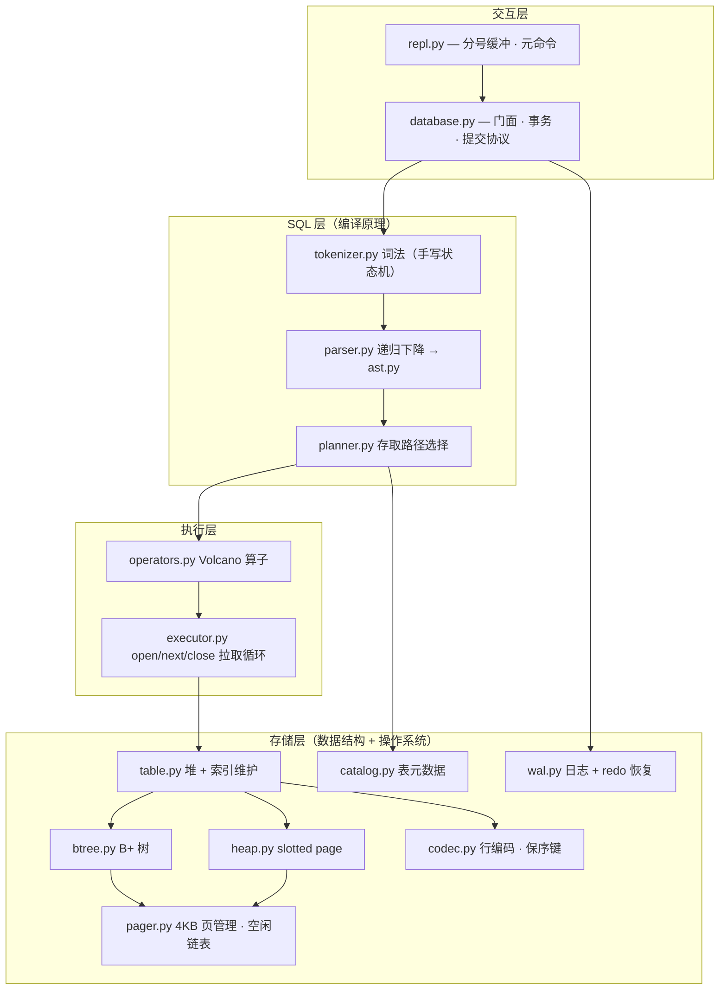

# MiniDB

> 用 408 的知识，从零写一个教学级嵌入式 SQL 数据库。
> 纯 Python 标准库 · 零第三方依赖 · Windows / Linux / macOS 通用。

4KB 页式堆存储、B+ 树索引、手写递归下降 SQL 解析器、Volcano 迭代器执行器、
WAL + redo 崩溃恢复 —— 每一层都是可读、可跑、可改的完整实现，
对标 tinysdb / toydb / CMU 15-445 simpledb / cstack db_tutorial 的教学定位。

---

## 快速上手（3 条命令）

```bash
python -m unittest discover -s tests -v   # 93 个测试一键全绿（含崩溃恢复）
python demo.py                            # 端到端演示：建表→30行→聚合→崩溃→恢复
python -m minidb                          # 交互式 REPL（分号多语句 + .tables/.schema）
```

REPL 里可以马上试：

```sql
CREATE TABLE student (id INT PRIMARY KEY, name VARCHAR(64) NOT NULL, score FLOAT);
INSERT INTO student VALUES (1, 'Alice', 92.5), (2, 'Bob', 87.0);
SELECT name, score FROM student WHERE score > 90 ORDER BY score DESC;
EXPLAIN SELECT name FROM student WHERE id = 1;
```

Python 嵌入接口同样三行：

```python
from minidb import connect
db = connect("demo.db")
print(db.query("SELECT COUNT(*) FROM student;"))
```

---

## 架构图



终端友好的分层视角：

```
   +----------------------------------------------+
   |  REPL / Python API（repl.py · database.py） |  事务边界、崩溃恢复入口
   +----------------------------------------------+
   |  SQL：tokenizer → parser → ast → planner    |  词法/语法/语义三段式
   +----------------------------------------------+
   |  执行：Volcano 算子树 + executor 拉取循环    |  SeqScan/IndexScan/Filter/...
   +----------------------------------------------+
   |  表与索引：table.py（堆扫描 + B+ 树维护）    |
   +----------------------------------------------+
   |  存储：heap slotted page · btree · catalog  |
   |        pager（页分配/空闲链表）· wal（日志） |
   +----------------------------------------------+
              ^ 全部建立在 codec.py 的字节编解码之上
```

---

## 支持的 SQL

`CREATE TABLE`（INT/TEXT/FLOAT，`PRIMARY KEY` / `NOT NULL`，`VARCHAR(n)` 长度修饰接受但不执行）、
`CREATE [UNIQUE] INDEX`（最左前缀、自动回填、UNIQUE 建索引时校验存量数据）、
`INSERT`（多行、列子集）、`SELECT`（`WHERE` 比较/`AND`/`OR`/`NOT`/`IS [NOT] NULL`、
`GROUP BY`、`COUNT/SUM/AVG/MIN/MAX`、`ORDER BY` 多键升降序、`LIMIT/OFFSET`、
表达式投影与别名）、`UPDATE`、`DELETE`、`EXPLAIN`。
错误一律带行列号与语义化异常类型，失败语句整体回滚。

---

## 分模块设计与取舍

### 存储：4KB slotted page（`pager.py` + `heap.py`）

页内三段式：页头 → 槽位目录（向前长）→ 记录体（向后长），中间是空洞。
删除只打 `0xFFFF` 墓碑，空洞攒多了才压缩。**取舍**：比「记录追加 + 偏移表」
多一次间接寻址，换来原地更新与碎片回收 —— 这正是 InnoDB 行存储的骨架，
也是 408 里「页式存储管理 + 外部碎片」的活标本。

### 索引：B+ 树（`btree.py`）+ 保序键编码（`codec.py`）

所有查找、分裂、叶子链扫描都建立在一个前提上：**字节序 == 值序**。
INT 编码翻转符号位（负数全部落进无符号前半区）、TEXT 加 `0x00` 终结符
（前缀自由，`ab` 永远排在 `abc` 前且不互为前缀）、NULL 用最小标签。
有了它，B+ 树只需 `bytes < bytes` 比较，memcmp 即排序 —— 与真实数据库
完全同款。**取舍**：删除不做再平衡（懒惰删除），教学叙事优先，
Roadmap 里再补合并。

### 解析：手写 tokenizer + 递归下降（`tokenizer.py` + `parser.py` + `ast.py`）

不用正则、不用 parser generator：逐字符状态机产出带行列号的 token，
每个文法产生式对应一个函数，优先级用调用栈天然分层
（`parse_or → parse_and → parse_not → parse_comparison → ...`）。
**取舍**：手写代码量约为生成器方案的 3 倍，但错误定位精确到行列、
文法演进随手改 —— 递归下降本身就是编译原理课「自顶向下分析」的实现题。

### 执行：Volcano 迭代器（`operators.py` + `executor.py` + `planner.py`）

每个算子只实现 `open / next / close`，`next` 一次吐一行；
`Filter` 可短路丢行，`Sort` 必须物化，`Update/Delete` 先物化匹配行再改
（避免游标踩到自己搬走的行）。计划器按三条规则选路径：
主键等值/范围 → 主键索引；二级索引最左前缀等值 → 二级索引；
`ORDER BY` 恰为主键升序 → 索引天然有序免 `Sort`。`EXPLAIN` 把选择打印出来。
**取舍**：物化型算子（Sort/Aggregate）与流式算子混在同一套接口里，
是教学上「一把梭」的最优解；代价模型优化器留给 Roadmap。

### 事务与恢复：整页映像 WAL + 纯 redo（`wal.py` + `database.py`）

提交协议四步：脏页映像进 WAL → `COMMIT` + fsync（**持久化点**）→
分两批回写数据页 → 截断 WAL（checkpoint）。启动时扫 WAL、CRC 校验、
把最后一次 COMMIT 之前的页映像 redo 回文件，**幂等**重放，撕裂尾部记录
靠长度+CRC 自然截断。**取舍**：提交时才写日志，依赖「单进程单语句事务、
脏页从不提前落盘」的前提 —— 日志量减半、恢复只有 redo；
真正的生理日志（undo、CLRs）需要 ARIES，是 Roadmap 的第一项。
故障注入点（`before_commit / after_commit / mid_writes / before_truncate`）
把「进程任意时刻被 kill」变成可测试的确定性场景。

### 元数据：独立 catalog 页链（`catalog.py`）

表结构序列化成 JSON 存在页链里（页 0 记 `catalog_start`），
**取舍**：不如 SQLite「用 B+ 树存 B+ 树」的自举优雅，但避免了
「系统表本身要谁来建」的鸡生蛋问题，且让 catalog 与数据页
**同一次事务提交**落地 —— 不会出现「表头说有 3 页、实际只有 2 页」。

---

## 与 408 考点的对应

**数据结构**：B+ 树插入/分裂/有序性论证（`btree.py`，考点重灾区）、
叶子链表范围扫描、散列表分桶（`GROUP BY` 的哈希聚合）、
NULL 位图（位运算）、递归（递归下降解析器本身就是递归的应用）。

**操作系统**：页式存储管理与地址翻译（4KB 页 + 页号→文件偏移）、
物理块分配与空闲链表（LIFO 回收 + 复用清零，防信息泄漏）、
缓冲池与脏页管理（`pager` 的页缓存、写回时机）、
fsync 与崩溃一致性（WAL 的持久化点就是 fsync 语义）、
redo 日志与检查点（数据库故障恢复 = 操作系统日志文件系统重建的同族问题）。

**编译原理**：词法分析（状态机、最长匹配、行列号跟踪）、
语法分析（递归下降、优先级分层、错误恢复）、AST、
语义分析（类型检查在 `codec._coerce`、约束检查在 `table._check_constraints`）。

一句话：**408 三门课的知识在本项目里各自有一块 500 行上下的实体代码**，
复习时可以把「书上的概念」和「跑得通的实现」互相印证。

---

## 测试

```bash
python -m unittest discover -s tests -v
```

93 个用例、7 个文件，约 900 行：存储（编解码/页分配/堆 CRUD）、
B+ 树（分裂/叶子链/边界范围）、解析（全语法 + 错误定位）、
执行（端到端 SQL、索引计划、约束回滚）、**崩溃恢复**（四个故障点逐一注入 →
kill → 重开 → 断言数据完好或按语义丢弃）、REPL（缓冲/元命令/错误存活）。

崩溃恢复测试的思路：`Database.kill()` 直接关句柄不提交，
等价于进程收到 SIGKILL 后用户态内存蒸发、磁盘留半截状态；
`connect()` 时启动恢复，测试断言 redo 的结果。

---

## Roadmap

- **ARIES 生理日志**：undo + CLR，让恢复不只 redo（`wal.py` 扩展）
- **MVCC**：多版本行 + 快照隔离，写不阻塞读（`heap.py` 版本链）
- **B+ 树并发控制**：latch crabbing / OLC，多事务安全分裂
- **JOIN 与子查询**：嵌套循环 / 散列连接、`HAVING`
- **代价模型优化器**：统计信息 + 索引选择代价估算
- **更多类型与函数**：DATE、BLOB、CASE 表达式
- **工程化**：在线备份、WAL 归档、页压缩

---

## English Summary

MiniDB is a teaching-grade embedded SQL database written from scratch in pure
Python (standard library only, no third-party dependencies). It implements a
4KB slotted-page heap storage with a free-list page allocator, a B+ tree for
primary and secondary indexes (with order-preserving key encoding so that
memcmp equals value ordering), a hand-written tokenizer and recursive-descent
SQL parser, a Volcano-style iterator executor with a rule-based access-path
planner (`EXPLAIN` included), and a write-ahead log with idempotent redo
crash recovery — commit protocol: page images → COMMIT + fsync → write-back →
checkpoint. The test suite (93 cases) covers storage, B+ tree, parsing,
execution and simulated-crash recovery, runnable with a single command:
`python -m unittest discover -s tests -v`. The codebase maps directly onto
China's 408 postgraduate CS exam syllabus: data structures (B+ tree, hash
aggregation), operating systems (paged storage, free lists, WAL/fsync, crash
recovery) and compiler principles (lexical analysis, recursive descent,
semantic checks). MIT licensed.

---

## License

MIT，见 [LICENSE](LICENSE)。
